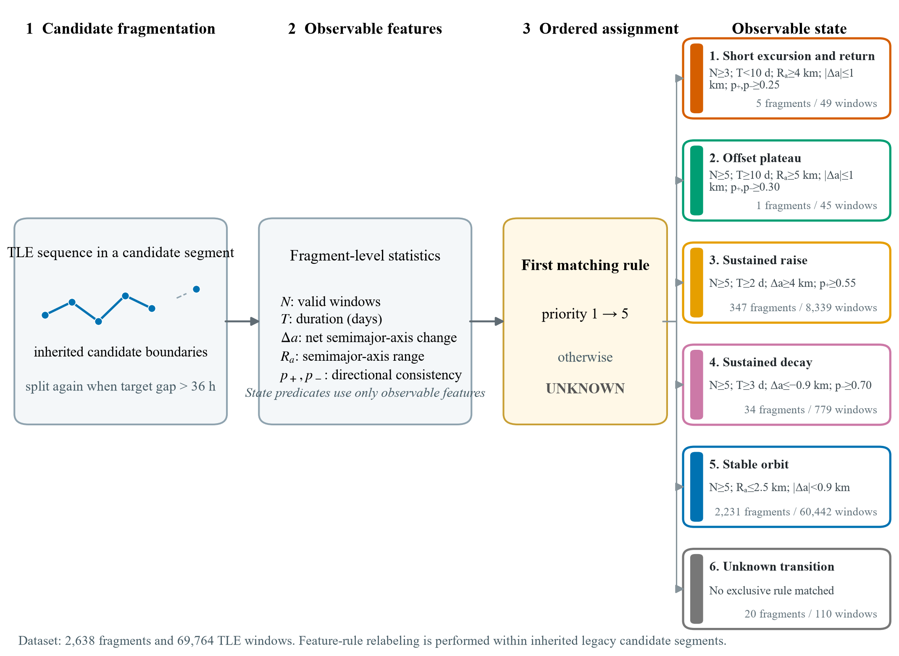
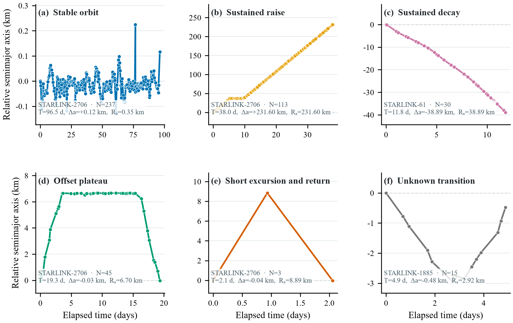
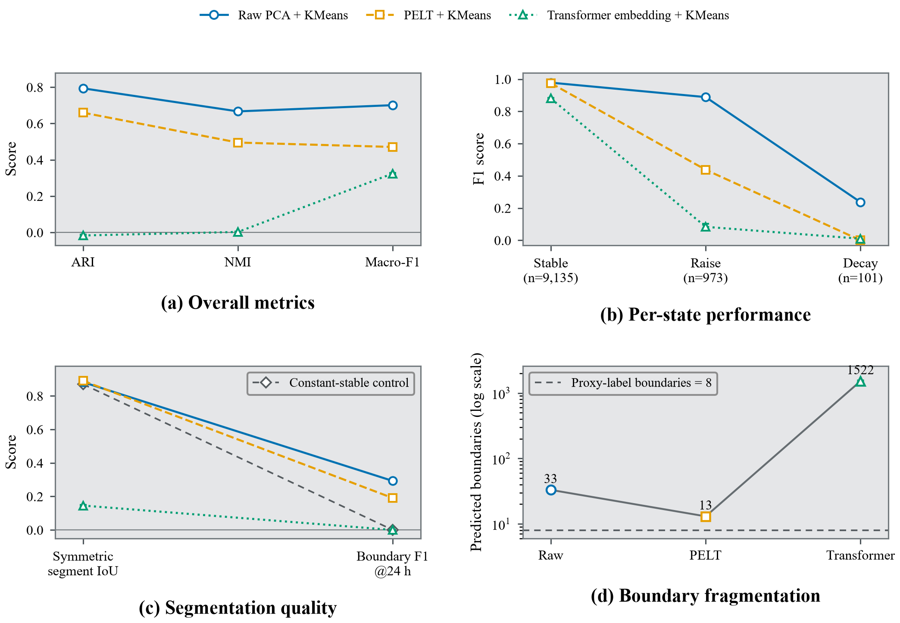

# TLE Observable-State Use Case: Figures and Results

## Figure assets

**Figure 1. Observable-state feature-rule relabeling workflow.** Candidate boundaries are inherited from the prior rule pipeline and are additionally split at target gaps longer than 36 h. Within each candidate segment, labels are assigned only from six observable fragment statistics using the first satisfied predicate in the ordered rule set. This is feature-rule relabeling within inherited candidates, not an intent-free segmentation pipeline. Counts refer to the full train+validation+test v2 label set.

**Figure 2. Illustrative, hand-selected TLE-observable fragments.** Each panel shows semimajor-axis change relative to the fragment start against true elapsed UTC time. Axes are independently scaled because state amplitudes span more than three orders of magnitude. Panels show (a) stable orbit, (b) sustained raise, (c) sustained decay, (d) offset plateau, (e) short excursion and return, and (f) unknown transition. Four examples come from STARLINK-2706; the complete data contain only one offset-plateau fragment and five short-excursion fragments, so these two panels are qualitative cases rather than population summaries.

**Figure 3. Retrospective K=3 comparison under the v2 observable-state proxy labels.** Only stable, sustained-raise, and sustained-decay classes enter quantitative evaluation; cluster-to-class Hungarian mappings are fit using training labels only. Panels report (a) clustering and mapped classification scores, (b) per-state F1 with test support, (c) symmetric segment IoU and boundary F1, and (d) predicted boundary counts. Bars show mean and standard deviation over seeds 42/43/44 on the same retrospective slice of 10,209 windows and 376 NORAD targets. Decay has 101 windows and the slice has only 8 proxy-label boundaries. Gray diamonds in (c) show the constant-stable control (segment IoU 0.8705, boundary F1 0); high segment IoU is therefore strongly influenced by the 9,135 stable windows. Labels describe observable trajectory shape, not operational intent.

## Dataset composition

Counts in this table cover the complete train+validation+test v2 dataset, not only the test slice.

| Observable state | Fragments | Windows | Evaluation role |
|---|---:|---:|---|
| Stable orbit (`STABLE_ORBIT`) | 2,231 | 60,442 | Primary quantitative |
| Sustained raise (`SUSTAINED_RAISE`) | 347 | 8,339 | Primary quantitative |
| Sustained decay (`SUSTAINED_DECAY`) | 34 | 779 | Primary quantitative |
| Offset plateau (`OFFSET_PLATEAU`) | 1 | 45 | Qualitative case |
| Short excursion and return (`SHORT_EXCURSION_RETURN`) | 5 | 49 | Qualitative case |
| Unknown transition (`UNKNOWN_TRANSITION`) | 20 | 110 | Abstention / excluded from mapping |

## Overall test performance

| Method | ARI | NMI | Macro-F1 | Symmetric segment IoU | Boundary-F1@24h | Predicted boundaries |
|---|---:|---:|---:|---:|---:|---:|
| Constant stable (control) | 0.0000 | 0.0000 | 0.3148 | 0.8705 | 0.0000 | 0 |
| Raw PCA + KMeans | **0.7938 ± 0.0003** | **0.6668 ± 0.0006** | **0.7010 ± 0.0003** | 0.8826 ± 0.0002 | **0.2927 ± 0.0000** | 33.0 ± 0.0 |
| PELT + KMeans | 0.6598 ± 0.0000 | 0.4951 ± 0.0000 | 0.4708 ± 0.0000 | **0.8905 ± 0.0000** | 0.1905 ± 0.0000 | 13.0 ± 0.0 |
| Transformer embedding + KMeans | -0.0168 ± 0.0042 | 0.0026 ± 0.0016 | 0.3244 ± 0.0043 | 0.1455 ± 0.0053 | 0.0000 ± 0.0000 | 1522.3 ± 52.3 |

The constant-stable control is deterministic rather than a three-seed estimate. The test slice contains 8 proxy-label primary-state boundaries. Higher is better for all score columns; predicted-boundary count is diagnostic and should be interpreted relative to 8 rather than maximized. The control's 0.8705 segment IoU shows that this metric is strongly affected by the dominance of stable windows.

## Per-state test performance

| Method | State | Support | Precision | Recall | F1 |
|---|---|---:|---:|---:|---:|
| Raw PCA + KMeans | Stable orbit | 9,135 | 0.9982 ± 0.0000 | 0.9588 ± 0.0001 | 0.9781 ± 0.0000 |
| Raw PCA + KMeans | Sustained raise | 973 | 0.9735 ± 0.0007 | 0.8171 ± 0.0010 | 0.8884 ± 0.0007 |
| Raw PCA + KMeans | Sustained decay | 101 | 0.1375 ± 0.0002 | 0.8416 ± 0.0000 | 0.2364 ± 0.0003 |
| PELT + KMeans | Stable orbit | 9,135 | 0.9521 ± 0.0000 | 0.9986 ± 0.0000 | 0.9748 ± 0.0000 |
| PELT + KMeans | Sustained raise | 973 | 0.9927 ± 0.0000 | 0.2806 ± 0.0000 | 0.4375 ± 0.0000 |
| PELT + KMeans | Sustained decay | 101 | 0.0000 ± 0.0000 | 0.0000 ± 0.0000 | 0.0000 ± 0.0000 |
| Transformer embedding + KMeans | Stable orbit | 9,135 | 0.8924 ± 0.0006 | 0.8674 ± 0.0063 | 0.8797 ± 0.0031 |
| Transformer embedding + KMeans | Sustained raise | 973 | 0.1048 ± 0.0212 | 0.0695 ± 0.0181 | 0.0836 ± 0.0199 |
| Transformer embedding + KMeans | Sustained decay | 101 | 0.0056 ± 0.0041 | 0.0396 ± 0.0297 | 0.0098 ± 0.0073 |

## Reporting boundary

These values measure recovery of mutually exclusive **TLE-observable trajectory shapes**, not operator intent, maneuver cause, or an operational lifecycle phase. Because the v2 rules were organized after the original frozen test had been consumed, the numbers are a retrospective relabeling analysis rather than a new unseen final test. Boundary metrics are diagnostic because the test slice contains only 8 proxy-label boundaries.

Raw sources: [`summary_by_system.csv`](../../reports/observable_regime_feature_labels_v2/retest/summary_by_system.csv), [`per_class_summary.csv`](../../reports/observable_regime_feature_labels_v2/retest/per_class_summary.csv), and [`metrics_long.csv`](../../reports/observable_regime_feature_labels_v2/retest/metrics_long.csv).
